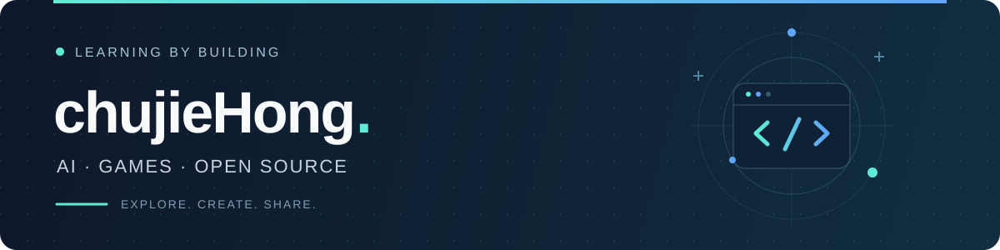

  

  你好，我是 <strong>chujieHong</strong>，一个 AI、游戏爱好者。 
  这里记录着我从零开始学习编程的足迹，很高兴能和你相遇。

## 01 · 关于我

- **现在** — 大二学生，正在系统地学习计算机基础知识。
- **学习** — 系统学习 AI Agent 架构与工程实践，探索自主规划、工具调用与多智能体协作。
- **方向** — 打好基础，未来向全栈 / AI 方向发展。
- **兴趣** — 写代码、逛 GitHub 看大牛的项目、研究各种开源工具。
- **交流** — 欢迎交流，有问题可以直接找我。

## 02 · 开源贡献

| 开源项目 | 参与情况 |
| :--- | :--- |
| **[TinyVue](https://github.com/opentiny/tiny-vue)** | **6 PR** · 4 Issue（3 个已做） |
| **[Octop](https://github.com/TencentCloud/Octop)** | **Maintainer** · 20+ PR |

## 03 · 个人项目

| 项目类别 | 项目 | 简介 |
| :--- | :--- | :--- |
| 个人项目 | **[m1 · LLM Toolkit](https://github.com/chujieHong/m1)** | 多模型 CLI + Web 工具，支持流式对话、Prompt 模板与用量统计。 |
| 上海 Clawhunt 参赛项目 商业化赛道 | **[CreateWorldAgent](projects/CreateWorldAgent.md)** 🔒 私有源码 · 公开介绍 | 面对普通用户，将小说、剧本等故事材料改编为 2D 像素剧情游戏的本地 AI 工作台，同时是开源共创、二创以及多 IP 交融的游戏开发生态。 |
| Xihack 2026 西客松参赛项目 企业赛道 | **[zhishan-tiangong](https://github.com/chujieHong/zhishan-tianggong)** 知膳 · 天工 | 基于联网称重的智能供餐系统，提供实时监测、厨房看板与 AI 分析（团队作品）。 |
| 个人项目 | **[ai-news-crawler](https://github.com/chujieHong/ai-news-crawler)** | 基于 FastAPI + Vue 的 AI 资讯聚合系统，支持定时抓取、智能筛选与全文搜索。 |

## 04 · 技术栈

  <strong>编程语言</strong>  
  
  
  
  
  
  

  <strong>Web 开发</strong>  
  
  
  
  

## 05 · 贡献贪吃蛇

  <picture>
    <source media="(prefers-color-scheme: dark)" srcset="https://raw.githubusercontent.com/chujieHong/chujieHong/output/github-contribution-grid-snake-dark.svg" />
    <source media="(prefers-color-scheme: light)" srcset="https://raw.githubusercontent.com/chujieHong/chujieHong/output/github-contribution-grid-snake.svg" />
    
  </picture>

---

  <strong>感谢来访，欢迎交流。</strong> 
  如果喜欢这个主页，欢迎 Star ⭐

  

